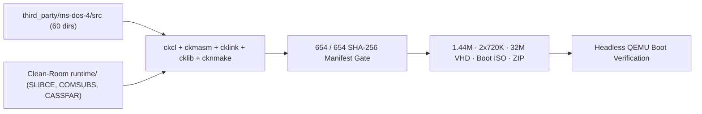

## Reproducible Native Build Pipeline

`CK-DOS 4.0` keeps `third_party/ms-dos-4/` completely frozen as a reproducible historical reference while replacing every legacy 1988 DOS build executable (`MASM.EXE`, `CL.EXE`, `LINK.EXE`, `LIB.EXE`, `NMAKE.EXE`, `EXE2BIN.EXE`) with clean-room native host binaries:

Looking for high-memory `DOS=HIGH,UMB` (`615.7 KB` free RAM), **CK Basic (`QBASIC.EXE`)**, **CK Edit (`EDIT.COM`)**, and **CK Help (`HELP.COM`)**? Switch to **[CK-DOS 5.0](../dos5/index.md)** using the site selector in the header.
