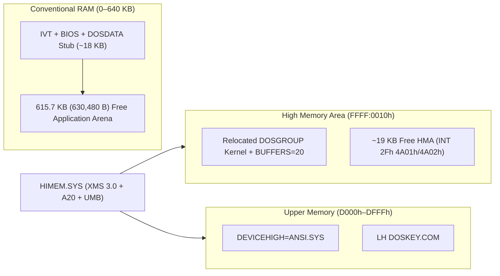

## Architecture at a Glance

`CK-DOS 5.0` (`os/ck-dos-5/`) combines an slimmed, DOS 5.0-ABI-aligned evolution of the MIT-licensed MS-DOS 4.00 kernel with clean-room, first-party 16-bit drivers and full-screen applications (`Copyright (c) 2026 C. Klukas`). For seamless compatibility with classic DOS batch scripts, books, and tools, executables use standard DOS 5 filenames (`QBASIC.EXE`, `EDIT.COM`, `HELP.COM`, `HIMEM.SYS`, `DOSKEY.COM`, `SETVER.EXE`, `LOADFIX.COM`, `EXPAND.EXE`).



## Quick Boot in QEMU

```sh
# Boot the 32 MB pre-installed CK-DOS 5.0 hard disk (includes C:\DOS + C:\DEVTOOLS):
qemu-system-i386 -m 4M -drive file=dist/ckdos-5.00-hdd-32m.vhd,format=vpc -boot c

# Or boot from the 1.44 MB install diskette or El-Torito CD-ROM ISO:
qemu-system-i386 -m 4M -fda dist/ckdos-5.00-floppy-1440k.img -boot a
qemu-system-i386 -m 4M -cdrom dist/ckdos-5.00-boot.iso -boot d
```

Looking for the frozen 654-hash MS-DOS 4.00 reference build or the cross-compiler toolchain manual? Switch to **[CK-DOS 4.0 & SDK](../dos4/index.md)** from the site selector in the header.
